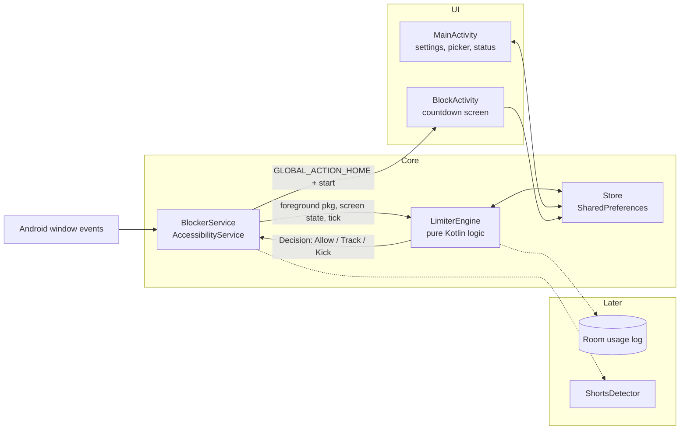
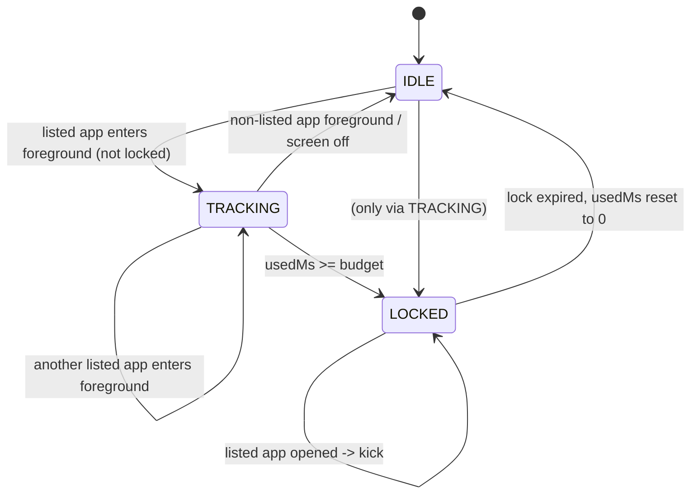

# FocusGuard — Design Document

Related: `PRD.md` (what), `ANDROID_NOTES.md` (platform constraints), `TASKS.md` (build order).

---

## 1. Architecture overview



**Principles**
- The service only translates Android events into engine calls and engine decisions into Android actions.
- The engine has no Android imports so it can be unit tested on the JVM.
- All persistent state is in `Store`. UI reads state from `Store`; it never talks to the service directly.

## 2. Current vs. target structure

| Component | Phase 1 (exists) | Target (Phase 2+) |
|---|---|---|
| `Store` | SharedPreferences wrapper with `usedMs`, `lockedUntil`, `blocked`, `budgetMin`, `cooldownMin` | Adds lock anchors (§8), pending settings (§6), implements `StateStore` interface |
| `BlockerService` | Contains timing and decision logic | Thin adapter calling `LimiterEngine` |
| `LimiterEngine` | Does not exist | Pure Kotlin, injected `Clock` and `StateStore` |
| `BlockActivity` | Countdown with `CountDownTimer` | Same; reads lock state from `Store` |
| `MainActivity` | Settings and picker | Adds status card, disabled-while-locked behaviour, usage history |

## 3. State machine

States are derived from stored data, not kept only in memory.



| State | Meaning | Stored as |
|---|---|---|
| IDLE | No listed app in foreground, or screen off | `lockedUntil == 0` and no active tracking |
| TRACKING | A listed app is foreground and screen on; ticks run | In-memory `trackedPkg`, usage persisted every 5 s |
| LOCKED | Lock active | `lockedUntil` (plus anchors, §8) in the future |

## 4. Engine contract

```kotlin
interface Clock {
    fun elapsedRealtime(): Long      // monotonic, includes deep sleep
    fun wallTime(): Long             // System.currentTimeMillis()
    fun bootCount(): Int             // Settings.Global.BOOT_COUNT
}

interface StateStore {
    var budgetMin: Int
    var cooldownMin: Int
    var usedMs: Long
    var lockedUntilWall: Long
    var lockStartElapsed: Long
    var lockStartWall: Long
    var lockBootCount: Int
    var blocked: Set<String>
}

sealed interface Decision {
    data object Allow : Decision          // do nothing
    data object Tracking : Decision       // keep or start ticking
    data class Kick(val lockedUntilWall: Long) : Decision // go Home + show block screen
}

class LimiterEngine(private val clock: Clock, private val store: StateStore) {
    fun onForegroundChanged(pkg: String?): Decision   // pkg == null means "none/ignored context"
    fun onTick(): Decision                            // called each second while tracking
    fun onScreenOff()
    fun remainingLockMs(): Long
    fun isLocked(): Boolean
}
```

Rules implemented inside the engine:
1. `onForegroundChanged(pkg)`: refresh expired lock first. If `pkg` is listed: locked → `Kick`; else → `Tracking`. If not listed → stop tracking, `Allow`.
2. Usage is added as `elapsed - lastTickElapsed`, using monotonic time. A single delta larger than 5 s (e.g. after deep sleep) is clamped to 2 s to avoid counting time the screen was effectively off.
3. `onTick()`: add delta; if `usedMs >= budget` → start lock and return `Kick`.
4. Lock start records `lockStartElapsed`, `lockStartWall`, `lockBootCount`, `lockedUntilWall = wall + cooldown`.
5. `onScreenOff()` stops tracking and persists usage.

## 5. Android event handling rules

The service receives `TYPE_WINDOW_STATE_CHANGED`. Map every event as follows:

| Source package | Action |
|---|---|
| Own app | Ignore (do not change state) |
| `com.android.systemui` | Ignore (notification shade, recents, volume UI) |
| Enabled keyboard packages | Ignore |
| Listed app | `engine.onForegroundChanged(pkg)` |
| Anything else (launcher, other apps) | `engine.onForegroundChanged(otherPkg)` which stops tracking |

Additional triggers:

| Trigger | Action |
|---|---|
| `ACTION_SCREEN_OFF` | `engine.onScreenOff()` |
| `ACTION_USER_PRESENT` | Read `rootInActiveWindow.packageName`; pass to `onForegroundChanged` (covers unlocking straight into a listed app) |
| Service connected | Recompute IME list; if lock active and a listed app is foreground, kick |
| Service destroyed | Persist usage; remove callbacks |

Threading: events arrive on the main thread. Engine calls are cheap. `SharedPreferences.apply()` is async; ticks use a main-thread `Handler`.

## 6. Settings protection (FR-12, FR-13)

- While `isLocked()`: `MainActivity` disables budget, lock, app picker; shows "Locked — unlocks in mm:ss".
- Loosening changes made while unlocked are stored as **pending** (`pendingBudgetMin`, `pendingCooldownMin`, `pendingBlocked`, `pendingAppliedAtWall`) and applied by the engine on the next refresh once 10 minutes have passed. The main screen shows "Pending change applies in mm:ss".
- Tightening changes (lower budget, higher lock, more apps) apply immediately.
- Loosening is defined as: budget increases, lock decreases, or any app is removed from the list.

## 7. Edge cases

| Case | Behaviour |
|---|---|
| Screen turns off while tracking | Stop tracking, persist usage. |
| Switch between two listed apps | Keep tracking; usage is continuous and shared. |
| Notification shade or keyboard appears over a listed app | Ignored; tracking continues. |
| Lock expires while the user is on the home screen | Next refresh clears it; block screen finishes itself. |
| Reboot during lock | Lock persists. Remaining time computed per §8. |
| Service process killed mid-tracking | At most 5 s of usage lost (persist interval). |
| Budget lowered to below `usedMs` | Next tick or event triggers the lock immediately. |
| Accessibility service disabled by user | Limits stop. Main screen shows red status when opened; optional notification (FR-18). |
| Picture-in-picture video or background audio | Not counted while the host app is not the foreground window. Known limitation. |
| Split-screen with a listed app | Event ordering is unreliable; the last event wins. Known limitation. |
| Two events for the same package in a row (dialogs, tabs) | Idempotent: tracking is not restarted. |
| Block screen launched while already visible | `singleTask` launch mode prevents stacking. |

## 8. Clock-tamper resistance (FR-14)

Stored at lock start: `lockStartElapsed`, `lockStartWall`, `lockBootCount`, `lockedUntilWall`.

Remaining lock time:
- If current `bootCount == lockBootCount`: `remaining = cooldownMs - (elapsedRealtime - lockStartElapsed)` (monotonic, immune to clock changes).
- Else (rebooted): `remaining = lockedUntilWall - wallTime`. Accepted weakness: rebooting and changing the clock can shorten the lock.

Also detect wall-clock jumps: if `wallTime - lockStartWall` is smaller than the elapsed delta by more than 60 s, treat the clock as tampered and trust the elapsed value.

## 9. UI design

### 9.1 Main screen (`MainActivity`)

```
┌──────────────────────────────────┐
│ FocusGuard                       │
│                                  │
│ ┌──────────────────────────────┐ │
│ │ ● Service ON                 │ │   red "Service OFF — tap to enable" when disabled
│ │ Used 12 / 30 min             │ │
│ │ [██████░░░░░░░░░░]           │ │
│ │ Locked — unlocks in 41:12    │ │   shown only while locked
│ └──────────────────────────────┘ │
│                                  │
│ Budget (min)       [ 30 ]        │
│ Lock duration (min)[ 60 ]        │
│ (pending change applies in 8:30) │
│                                  │
│ [ Enable accessibility service ] │
│ ⓘ Help: restricted settings,     │
│   battery, autostart             │
│                                  │
│ Apps to limit                    │
│ ☑ YouTube                        │
│ ☑ <manga app>                    │
│ ☐ ...                            │
│                                  │
│ Usage (last 7 days)   [Phase 3]  │
└──────────────────────────────────┘
```

Behaviour: status refreshes on `onResume` and every second while visible; inputs accept digits only; empty or zero values are rejected with an inline error; controls disabled while locked.

### 9.2 Block screen (`BlockActivity`)

- Full-screen, centered text: "Time's up" and "Unlocks in mm:ss".
- Back button: go Home. No buttons that open blocked apps.
- Closes itself when the countdown ends.
- Excluded from recents; `launchMode="singleTask"`.

### 9.3 Strings

All user-visible text lives in `strings.xml`: `a11y_desc`, `time_up`, `unlocks_in`, `service_on`, `service_off`, `locked_until`, `pending_change`, `help_title`, `help_body`.

## 10. Data model

### 10.1 SharedPreferences file `focusguard`

| Key | Type | Default | Notes |
|---|---|---|---|
| `budget` | Int | 30 | minutes |
| `cooldown` | Int | 60 | minutes |
| `used` | Long | 0 | ms, shared across listed apps |
| `lockedUntil` | Long | 0 | wall time ms; 0 = not locked |
| `lockStartElapsed` | Long | 0 | |
| `lockStartWall` | Long | 0 | |
| `lockBoot` | Int | -1 | |
| `blocked` | StringSet | empty | package names |
| `pendingBudget` / `pendingCooldown` | Int | -1 | -1 = none |
| `pendingBlocked` | StringSet | null | null = none |
| `pendingAt` | Long | 0 | wall time when the pending change applies |

### 10.2 Room (Phase 3 only)

```kotlin
@Entity(tableName = "usage_daily", primaryKeys = ["epochDay", "pkg"])
data class UsageDaily(
    val epochDay: Long,   // LocalDate.now().toEpochDay()
    val pkg: String,
    val durationMs: Long
)
```

- Written by the engine/service via a small `UsageLogger` that batches into the 5-second persist step (`UPDATE ... SET durationMs = durationMs + :delta`, insert if missing).
- Retention: delete rows older than 30 days on service start.
- Query: last 7 days grouped by `epochDay`, with per-app breakdown for a day on tap.

## 11. Phase 4 — YouTube Shorts-only (FR-16)

1. Add `typeWindowContentChanged` to the service config; throttle handling to once per 500 ms.
2. `ShortsDetector.isShortsVisible(root: AccessibilityNodeInfo?): Boolean` looks for node view IDs stored in a configurable list (default includes the Shorts player container ID verified on the user's installed YouTube version via Layout Inspector or `uiautomator dump`).
3. If "Shorts only" is on, for package `com.google.android.youtube`: `Tracking` only when `isShortsVisible`; otherwise `Allow`. While locked and Shorts is detected: Home + block screen. Regular YouTube remains usable.
4. Always recycle/avoid retaining `AccessibilityNodeInfo` references beyond the call.
5. Fallback: if no known ID matches for 3 consecutive Shorts attempts (user setting toggled but nothing detected), show a note on the main screen that detection may be outdated.

## 12. Phase 5 — Browser domains (FR-17)

- Add a domain list in settings (e.g. `mangadex.org`).
- For Chrome (`com.android.chrome`), on content change read the URL bar node (view ID `com.android.chrome:id/url_bar`, verify on device) and match the host against the list.
- A match is treated like a listed app: tracks time against the same budget; locked → Home + block screen.
- Limitation: incognito, other browsers and in-app browsers are not covered unless added.

## 13. Performance and battery

- Ticks (`Handler.postDelayed`) run only while `TRACKING`. No periodic work in IDLE.
- Disk writes: persist `usedMs` every 5 s while tracking, and on every state change; never on every tick.
- Event handling must complete in a few milliseconds; no I/O besides `apply()` in `onAccessibilityEvent`.
- Room writes (Phase 3) happen on a background dispatcher.

## 14. Security and privacy

- `canRetrieveWindowContent="true"` is required for `ACTION_USER_PRESENT` detection and Phases 4–5; the app must only read package names and specific view IDs, never text content of screens, and never store or log it.
- No network permission. Backups disabled (`allowBackup="false"`).
- Accessibility service description in `strings.xml` states the purpose plainly.

## 15. Open design decisions

| Decision | Current choice | Revisit if |
|---|---|---|
| SharedPreferences vs DataStore | SharedPreferences (simple, synchronous reads) | Multiple processes or complex migrations appear |
| Room vs flat file for usage log | Room | Dependency size becomes an issue |
| Compose for `BlockActivity` | Plain Views (fast, tiny) | UI gets more complex |
